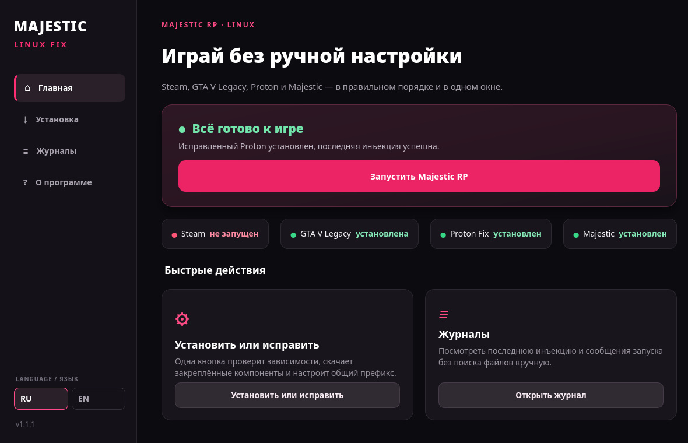

# Majestic RP Linux Fix

[](LICENSE)


A bilingual graphical installer, repair tool, and launcher for running Majestic RP with GTA V Legacy through Steam and Proton on Linux.

[Русская документация](README_RU.md) · [English documentation](README_EN.md)



## Highlights

- guided installation and repair from a native Qt 6 interface;
- separate patched Proton tool without modifying Proton Experimental;
- automatic checks for Steam, GTA V Legacy, Majestic, and the compatibility fix;
- shared Proton prefix for Majestic, Rockstar Launcher, and GTA V;
- bilingual Russian/English interface and KDE-friendly desktop integration;
- recoverable log clearing and sanitized log display.

## Quick start

Install Python 3 and PySide6, download this repository, then run:

```bash
python3 install_app.py
```

Open **Majestic RP Linux Fix** from the application menu and choose **Install or repair**. GTA V **Legacy** and Proton Experimental must already be installed through Steam.

## Project information

- [Third-party dependencies and attribution](THIRD_PARTY.md)
- [Changelog](CHANGELOG.md)
- [Architecture and distribution](ARCHITECTURE.md)
- [Security policy](SECURITY.md)

This repository contains no vendored third-party source code or binaries. The separately licensed runner is downloaded only after explicit consent, from a pinned commit, and verified by SHA-256.

Created by [Alley](https://github.com/Alleyv2). This is an unofficial community utility and is not affiliated with Majestic RP, Rockstar Games, Valve, or CodeWeavers.
